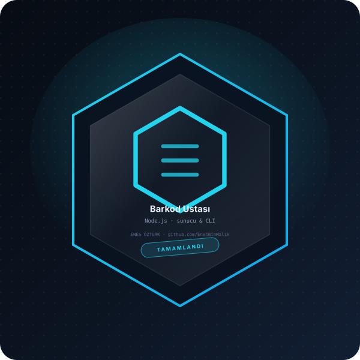

# Barkod Ustası



> **Node.js · sunucu & CLI** — tasarım ve geliştirme: **Enes Öztürk**

---

React ve TypeScript tabanlı tarayıcı barkod stüdyosu ve Node.js PNG oluşturma CLI'si.

## Öne çıkanlar

- Modül ve dosya sistemi kullanımı
- HTTP sunucusu ve rota yönetimi
- Asenkron akış ve hata yönetimi
- Komut satırı arayüzü

## Kurulum ve çalıştırma

```bash
npm install
npm run dev        # http://localhost:3000
```

| Komut | Not |
| --- | --- |
| `npm install` | bağımlılıklar |
| `npm run dev` | geliştirme sunucusu |
| `npm run build` | üretim derlemesi |

## Proje yapısı

```
├── index.html
├── package.json
├── docs/rozet.svg        # imza rozeti
└── src/                  # uygulama kaynakları
```

## Lisans

Bu proje **Enes Öztürk** tarafından geliştirilmiştir; tüm hakları saklıdır.
